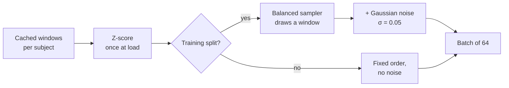
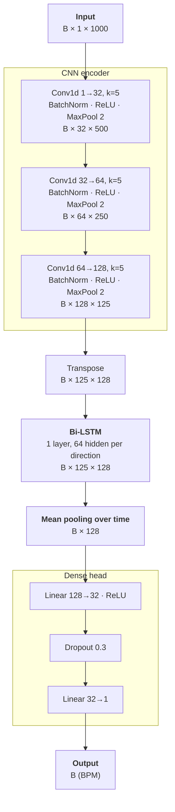
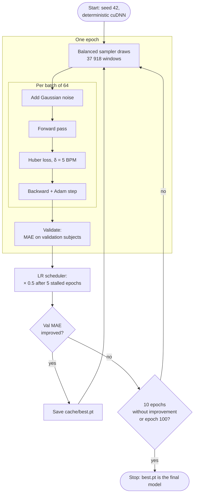

# Augmentation, Model Architecture and Training Loop

> [!abstract] At a glance
> A **CNN-BiLSTM** turns a 10 s PPG window (1 × 1000 samples at 100 Hz) into **one heart rate value in BPM**. It is trained against ECG-derived labels with **Huber loss**, **Adam** and **early stopping** on validation MAE. Training windows get **light Gaussian noise**, and a **balanced sampler** lets both sub-datasets contribute equally.

| | |
|---|---|
| **Input** | 1 bandpass-filtered PPG channel, 10 s window, z-scored |
| **Output** | 1 scalar: mean heart rate of the window (BPM) |
| **Label** | mean of the ECG-derived 1 Hz HR curve over the same 10 s |
| **Parameters** | 155 521 (all trainable) |
| **Code** | `src/bpm/dataset.py`, `src/bpm/model.py`, `scripts/train.py` |

---

## 1. Augmentation and Balancing

> [!info] Where this happens
> All of it is applied to the **training split only**. Validation and test windows are never augmented or resampled, so their metrics measure the real signal.



### 1.1 Per-window z-score

Every window is normalized on its own before it reaches the network:

$$
\tilde{x}_t = \frac{x_t - \mu_{\text{window}}}{\sigma_{\text{window}}}
$$

- Removes differences in PPG amplitude and offset between sensors, sites (ring, watch, earring, necklace, finger) and subjects. The network only sees the **shape** of the pulse wave.
- Done **once**, vectorized, when the dataset is created (`WindowDataset.__init__`), because z-scoring per item was too slow with `num_workers=0`.
- A flat-lined window (σ = 0) passes through unchanged instead of producing `NaN`.

### 1.2 Gaussian noise

> [!example] Rule
> `window + N(0, 0.05²)` on every training window, in z-scored units, **freshly drawn each time** the window is sampled.

- σ = 0.05 is 5 % of the window's standard deviation after z-scoring: enough to stop the network from memorizing exact sample values, too small to hide the pulse.
- Because the noise is new on every draw, a window that is sampled several times per epoch is never seen twice in exactly the same form.
- The random generator is seeded (`seed=42`), so a training run is reproducible.

> [!note] Deliberately light
> Heavier augmentation (time warping, cutout, amplitude scaling) was deferred until baseline numbers existed to compare against. Accelerometer noise and channel dropout were part of the original plan but were removed together with the exercise sub-dataset.

### 1.3 Balanced sampling

The two sub-datasets are very unequal in the training split:

| Sub-dataset | Train subjects | Train windows | Share of windows | Share of draws |
|---|---:|---:|---:|---:|
| Multisite-PPG | 14 | 28 000 | 74 % | **≈ 50 %** |
| WF-PPG | 19 | 9 918 | 26 % | **≈ 50 %** |

- `WeightedRandomSampler` gives every window the weight $1 / n_{\text{sub-dataset}}$, where $n_{\text{sub-dataset}}$ is the number of training windows in that window's sub-dataset (28 000 for Multisite-PPG, 9 918 for WF-PPG). Each sub-dataset's weights therefore sum to 1, so both have the same total weight and are drawn equally often.
- One epoch draws 37 918 windows **with replacement**. On average a WF-PPG window is drawn about 1.9 times per epoch and a multisite window about 0.7 times.
- Without this, the model would mostly learn the multisite data and treat the short controlled WF-PPG clips as a minority.

### 1.4 Per-subject cap

> [!warning] Why a cap is needed
> Multisite recordings last from ~40 min up to ~18 h. Without a cap, a few long recordings would produce most of the training windows.

- At most **2000 windows per multisite subject**, chosen at random (seed 42) when the cache is built (`src/bpm/cache.py`).
- The cap is applied per file and again per subject, so a single long file can't fill memory either.
- WF-PPG clips are short (2–7 min) and are not capped.

---

## 2. Model Architecture



### 2.1 Layer by layer

| # | Block | Operation | Output shape | Parameters |
|---:|---|---|---|---:|
| 0 | Input | 10 s PPG at 100 Hz | 1 × 1000 | – |
| 1 | Conv block 1 | Conv1d(1→32, k=5, same) · BN · ReLU · MaxPool(2) | 32 × 500 | 192 + 64 |
| 2 | Conv block 2 | Conv1d(32→64, k=5, same) · BN · ReLU · MaxPool(2) | 64 × 250 | 10 304 + 128 |
| 3 | Conv block 3 | Conv1d(64→128, k=5, same) · BN · ReLU · MaxPool(2) | 128 × 125 | 41 088 + 256 |
| 4 | Bi-LSTM | 1 layer, hidden 64, bidirectional | 125 × 128 | 99 328 |
| 5 | Pooling | mean over the 125 time steps | 128 | – |
| 6 | Dense | Linear(128→32) · ReLU | 32 | 4 128 |
| 7 | Regularization | Dropout(p = 0.3) | 32 | – |
| 8 | Output | Linear(32→1) | 1 | 33 |
| | **Total** | | | **155 521** |

> [!tip] Most of the capacity sits in the Bi-LSTM
> About 64 % of the parameters are in the Bi-LSTM, 33 % in the CNN and 3 % in the head.

### 2.2 CNN encoder: local pulse shape

- Three identical blocks: **convolution → batch normalization → ReLU → max pooling**.
- Kernel size 5 with `same` padding: each convolution looks at 5 neighboring samples, and the length is only reduced by pooling.
- Channels double per block (32 → 64 → 128) while the time axis halves (1000 → 500 → 250 → 125). The network trades time resolution for richer features.
- After the three blocks, each of the 125 time steps covers **36 input samples (0.36 s)**, and steps are 8 samples (80 ms) apart. That is about a third of a heartbeat at 60 BPM, enough to describe the upstroke, peak and dicrotic notch of a pulse.
- Batch normalization stabilizes training; max pooling makes the features robust to small shifts in time.

### 2.3 Bi-LSTM: rhythm across beats

- The 125 CNN feature vectors are read as a **sequence**, once forwards and once backwards.
- Each output step combines both directions (64 + 64 = 128 features), so it knows what happened **before and after** that point in the window.
- A 10 s window holds about 8–20 beats. The LSTM can use the regularity of the rhythm: a beat corrupted by motion can be inferred from its neighbours.

### 2.4 Pooling and regression head

- **Mean pooling** averages the 125 Bi-LSTM outputs into a single 128-dim vector. The label is also a mean (average heart rate over the window), so averaging over time matches the target.
- The **dense head** (128 → 32 → 1) maps this summary to a BPM value. The output layer is linear, with no activation, so any heart rate can be predicted.
- **Dropout 0.3** between the two dense layers is the only explicit regularization in the model. It is active during training only.

> [!note] Change from the original plan
> The plan used the same CNN + Bi-LSTM backbone, but with a **per-sample beat probability** (dense + sigmoid at every sample). The implementation predicts **one BPM value per window** instead, which is a regression task.

---

## 3. Training Loop



### 3.1 Hyperparameters

| Setting | Value | Notes |
|---|---|---|
| Batch size | 64 | |
| Optimizer | Adam | lr = 1e-3, default betas, no weight decay |
| Loss | Huber | δ = 5 BPM; `--loss mae` or `--delta <BPM>` for experiments |
| LR schedule | ReduceLROnPlateau | on validation MAE, factor 0.5, patience 5, min lr 1e-5 |
| Max epochs | 100 | |
| Early stopping | patience 10 | on validation MAE |
| Model selection | best validation MAE | saved as `cache/best.pt` (non-default runs: `cache/best_<tag>.pt`) |
| Seed | 42 | split, sampler, noise and weight init |
| Hardware | RTX 3080 (CUDA) | CPU fallback |

### 3.2 Loss: Huber with δ = 5 BPM

$$
L_\delta(e) =
\begin{cases}
\frac{1}{2}\, e^2 & \text{if } |e| \le \delta \\[4pt]
\delta \left( |e| - \frac{1}{2}\delta \right) & \text{otherwise}
\end{cases}
\qquad e = \hat{y} - y,\ \ \delta = 5\ \text{BPM}
$$

- **Small errors (≤ 5 BPM)** are penalized quadratically, like MSE: smooth gradients that shrink near the optimum.
- **Large errors (> 5 BPM)** are penalized linearly, like MAE: a few windows with wrong ECG labels (missed or extra R-peaks) cannot dominate the gradient.
- δ = 5 BPM matches the range in which a heart rate estimate is still considered accurate.

#### What the cap means: loss vs. gradient

What moves the weights is the **gradient** of the loss, not the loss itself:

$$
\frac{\partial L_\delta}{\partial e} =
\begin{cases}
e & \text{if } |e| \le \delta \\
\delta \cdot \operatorname{sign}(e) & \text{otherwise}
\end{cases}
$$

| Error | Huber loss | Huber gradient | MSE loss (½e²) | MSE gradient |
|---:|---:|---:|---:|---:|
| 1 BPM | 0.5 | 1 | 0.5 | 1 |
| 5 BPM | 12.5 | 5 | 12.5 | 5 |
| 20 BPM | 87.5 | **5** | 200 | 20 |
| 60 BPM | 287.5 | **5** | 1800 | 60 |

- **Below 5 BPM** Huber is identical to MSE: the gradient shrinks with the error, giving fine, stable steps near the right answer.
- **Above 5 BPM** the loss keeps growing, so a large error still counts as worse, but the **gradient is capped at 5**. A 60 BPM error pulls on the weights no harder than a 5 BPM error.

> [!important] Not "stricter on small errors"
> Huber does not punish small errors more. It **limits how strongly a single large error can pull** on the weights. With MSE, one window with a 60 BPM label error would pull 12× harder than a 5 BPM error; with Huber it pulls equally hard. The reasoning: a huge error is often not the model's fault but a wrong label (missed or extra R-peaks) or an unreadable PPG window, and such windows should not drag the whole model towards them.

### 3.3 Optimizer and learning rate scheduler

> [!info] Two separate jobs
> **Adam** decides how each weight moves at every batch. **ReduceLROnPlateau** decides the global learning rate that Adam works with, once per epoch.

| Level | Component | What it controls | When |
|---|---|---|---|
| Base value | `lr=1e-3` | starting learning rate $\eta_0$ | once, at start |
| Per weight | Adam | step size for each weight, scaled from its gradient history | every batch |
| Global | ReduceLROnPlateau | lowers $\eta$ when validation MAE stalls | every epoch |

#### Adam: per-weight steps

$$
\theta \leftarrow \theta - \eta \cdot \frac{\hat{m}}{\sqrt{\hat{v}} + \epsilon}
$$

- $\hat{m}$ is a running average of the gradient (momentum), $\hat{v}$ a running average of the squared gradient.
- Weights with large, noisy gradients take smaller steps; weights with small, consistent gradients take relatively larger ones.
- $\eta$ is the same for all weights. Adam never changes it; only the scheduler does.

#### ReduceLROnPlateau: global learning rate

```python
torch.optim.lr_scheduler.ReduceLROnPlateau(
    optimizer, mode="min", factor=0.5, patience=5, min_lr=1e-5
)
scheduler.step(val_mae)  # once per epoch, after validation
```

| Setting | Value | Meaning |
|---|---|---|
| Monitored metric | validation MAE | lower is better (`mode="min"`) |
| `patience` | 5 | tolerate 5 epochs without improvement; reduce on the 6th |
| `factor` | 0.5 | halve the learning rate |
| `min_lr` | 1e-5 | floor, never lower |

After $k$ reductions:

$$
\eta_k = \max\left(10^{-3} \cdot 0.5^{k},\ 10^{-5}\right)
$$

| Reductions $k$ | 0 | 1 | 2 | 3 | 4 | 5 | 6 | 7+ |
|---|---|---|---|---|---|---|---|---|
| Learning rate | 1e-3 | 5e-4 | 2.5e-4 | 1.25e-4 | 6.25e-5 | 3.1e-5 | 1.6e-5 | 1e-5 |

> [!tip] Why reduce the learning rate
> A high learning rate makes fast progress early but starts to jump around the minimum once the loss is close to it. Halving it when validation MAE stops improving lets the model take smaller, finer steps and settle into a better minimum.

> [!note] Interplay with early stopping
> Scheduler patience (5) is shorter than early-stopping patience (10). When training stalls, the learning rate is halved **once** before training stops, so the model gets a chance to improve at a lower rate first. The scheduler resets its own counter after each reduction, so a second halving would need 6 more stalled epochs, which early stopping does not allow. Any improvement resets both counters.
>
> One detail: the scheduler only counts an improvement if MAE drops by more than 0.01 % (PyTorch default `threshold=1e-4`), while the checkpoint and early stopping accept any drop.

### 3.4 One epoch, step by step

> [!example] Training phase: `model.train(True)`
> 1. The balanced sampler draws a batch of 64 window indices.
> 2. Each window gets fresh Gaussian noise.
> 3. **Forward pass** → 64 BPM predictions.
> 4. **Huber loss** against the ECG labels.
> 5. `optimizer.zero_grad()` → `loss.backward()` → `optimizer.step()`.
> 6. Loss and MAE are accumulated, weighted by batch size.

> [!example] Validation phase: `model.train(False)`
> 1. Validation windows in fixed order, **no noise**, no sampler.
> 2. Gradients disabled; batch norm uses its running statistics, dropout is off.
> 3. Validation **MAE** (BPM) is the only number used for the decisions below.

> [!example] End of epoch
> 1. **Scheduler:** if val MAE has not improved for 5 epochs, the learning rate halves (never below 1e-5).
> 2. **Checkpoint:** if val MAE is the best so far, the weights are saved to `cache/best.pt`.
> 3. **Early stopping:** after 10 epochs without improvement, training stops.
> 4. A log line is printed: `epoch N: train_loss=… train_mae=… val_mae=…`.

### 3.5 Why the validation set matters

> [!important] Three decisions, one signal
> Validation MAE drives the **learning rate schedule**, **checkpoint selection** and **early stopping**. The validation subjects (3 multisite, 4 WF-PPG) never appear in training, so these decisions favour generalization to new people rather than fitting the training subjects.

- The **test set** (7 more unseen subjects) is not touched during training. It is only used once, by `scripts/evaluate.py` and `notebooks/results.ipynb`.
- The model that is evaluated is the **best checkpoint**, not the weights of the last epoch.

### 3.6 Reproducibility

- `torch.manual_seed(42)` fixes weight initialization and sampler order.
- `torch.backends.cudnn.deterministic = True` removes run-to-run variation from cuDNN kernels.
- The subject split (`subject_wise_split`, seed 42) and the noise generator (seed 42) are seeded separately.
- `DataLoader(num_workers=0)`: all windows are already in RAM and z-scored, so the only per-item work is adding noise.

> [!quote] Commands
> ```bash
> .venv/bin/python scripts/train.py      # writes cache/best.pt
> .venv/bin/python scripts/evaluate.py   # test-set MAE / RMSE + Bland-Altman plots
>
> # loss experiments: non-default runs get their own checkpoint and plot folder
> .venv/bin/python scripts/train.py --delta 10                   # cache/best_huber10.pt
> .venv/bin/python scripts/train.py --loss mae                   # cache/best_mae.pt
> .venv/bin/python scripts/evaluate.py --ckpt cache/best_mae.pt  # plots in cache/plots/best_mae/
> ```
>
> `--loss huber|mae` (default `huber`), `--delta <BPM>` (Huber δ, default 5, ignored for `mae`). Early stopping and the LR schedule stay on validation MAE for every loss. `--ckpt <path>` (default `cache/best.pt`) picks the checkpoint `evaluate.py` scores.

---

## 4. Possible Investigations

### 4.1 Does the Huber cap cause the regression to the mean?

> [!question] Hypothesis (untested)
> On the test set the model **underestimates high heart rates**: on multisite data, windows with ECG > 100 BPM are still predicted around 80 BPM (fit slope 0.17, median absolute error 26 BPM above 100 BPM). The Huber gradient cap may contribute: it treats **real** large errors the same way as label errors. High-HR windows that the model gets badly wrong pull on the weights only as hard as a 5 BPM error, so there is little pressure to fix them.

**Why it is plausible**

- High-HR windows are uncommon in training: only **7.2 %** of training windows are above 100 BPM (median label 79.8 BPM), and most of them come from the free-living multisite data. In the test set the share is **17 %** (1443 of 8305 windows), so the model meets these windows more often than it learned from them.
- Their gradient is capped at 5 per window, while the many normal-HR windows near 80 BPM dominate the batch. Predicting "about 80" becomes a cheap compromise.

**Competing explanations**

- **Label distribution:** few training windows above 100 BPM, so the model rarely sees them, independent of the loss.
- **Signal quality:** free-living PPG at high HR is often motion-corrupted, so the information may not be in the input at all.

**How to test it**

> [!todo] Experiments
> - [ ] Retrain with **larger δ** (e.g. 10, 20 BPM: `train.py --delta 10`) and with **MSE**, keeping everything else fixed (seed 42). `--loss` offers `huber` and `mae` only, so MSE needs a new choice in `train.py`.
> - [ ] Compare on validation and test: **slope** of predicted vs ECG BPM, **error per HR bin** (> 90, > 100 BPM), and overall MAE.
> - [x] Check how rare high-HR windows are in training: 7.2 % above 100 BPM, 21.4 % above 90 BPM.
> - [ ] Plot the full **training label histogram** per sub-dataset next to the test distribution.

> [!success]- How to read the outcome
> - Slope rises and high-HR error drops with larger δ / MSE, without a large MAE increase elsewhere → the cap was part of the problem.
> - Nothing changes → the cause is more likely the label distribution or signal quality.
> - High-HR error drops but overall MAE gets clearly worse → label noise is real; a middle δ or reweighting high-HR windows may be the better trade-off.
